# 反面案例库（这里全是不好的写法，不要照抄）

来源：《黑帮老大的圣诞礼物》第 27 集（旧稿 → v2 → 成片 → 剪辑）和第 30 集（Gemini 照同一写法做的 v2 → 成片）。2026-11-24 用户要求保留反面教材、标明是不好的案例。

怎么用：
- 写之前扫一遍目录，写完跑 `build.js`。能查的都进了 `scripts/lib/check_v2.js`，报错的编号在每条后面。
- 每条都写：❌ 坏的写法（原句）→ 成片里变成了什么 → 为什么 → ✅ 好的写法 → 出处。
- `图/` 是成片抽帧，顶上有红条"反面案例"。`成稿/` 是整条的旧提示词，文件名以 `❌反面_` 开头，第一行也写着不要照抄。
- `案例.json` 给 `scripts/self_test.js` 用：把每条坏句子塞进一条好的提示词，检查脚本必须报出对应的编号。改了检查脚本就跑一遍。
- 以后看片发现新的坏例子：照同样格式加一条，图放进 `图/`，能查的同时加进 `案例.json` 和检查脚本。

证据等级：**看片**（成片里亲眼看到）、**用户**（用户原话指出）、**剪辑**（剪的时候被砍掉）、**推理**（还没有成片证据，先这么防）。

---

## 01 画面上半、下半（K2）｜用户
- ❌ `Faces stay in the upper two thirds of the frame`（旧稿 7 段每段都有）；`两只手在画面下半边`；`手腕在画面中上`；`no split screen, no panels, no picture in picture`
- 成片：画面会分开，像上下两张图拼的。
- 为什么：说"上半 / 下半"等于让模型把一张图分成两块；"不要分屏"也是在提分屏。
- ✅ 写成构图：`文森特落在左侧三分线上，目光望向右侧，前景是奥利维亚虚化的肩`。能用：三分线、黄金分割点、左侧 / 右侧、左上侧 / 左下侧、前景 / 中景 / 深处。谁高谁低用站、跪、坐、蹲写。

## 02 整集固定的站位（K4、X13）｜用户
- ❌ `站位：伊森身后永远是方向1；文森特打斗时身后是方向2……`（旧稿 7 段每段重复同一句）
- 成片：第二段开头人又回到第一段的站法，人排成一排。
- 为什么：第一段演完，人已经冲出去、倒下、换了边，固定句却还是开场的样子。
- ✅ 每段写【承接画面】= 上一段的【结束画面】，姿态、位置、手里、脸朝哪四格逐字一样（账本"开场 / 收场"，build.js 的 L1 会核）。隔了几段才再出现的人，接他最后一次的状态。

## 03 方向照别的图写（K5 + 环 3 第 25 条）｜用户、看片
- ❌ 场景卡照本地一张 v3 图写左右；平台上 @ 的是另一张（S50 飞书现图）。
- 成片：左右全反。
- ✅ 先下载平台上真正 @ 的那张总览图，在它的俯视格里标出每个人和机位，再推每个方向的画面左、画面右。场景卡"依据"写清是哪一格。

## 04 图里没有的方向（K4）｜看片
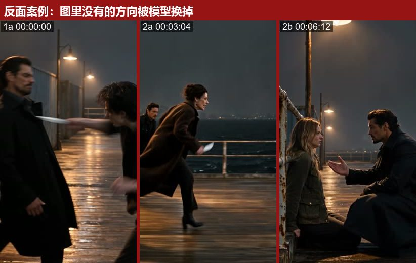
- ❌ `机位：全景 28mm｜朝集装箱｜背靠湖栏……`（总览图里没有这个角度，是我们推出来的）
- 成片：三条里，一条变成朝尽头，一条背景变成湖和栏杆，一条左右翻了面（图里三格：都写的"朝集装箱"）。
- 为什么：没有图撑着，模型照它见过的角度换一个。E30 的"朝玻璃墙"也翻过。
- ✅ 只用总览图里有的方向。剧情一定要新方向：先出一张这个方向的图、人看过左右，再写。

## 05 看不懂的孤立特写、空镜（K15）｜用户、剪辑
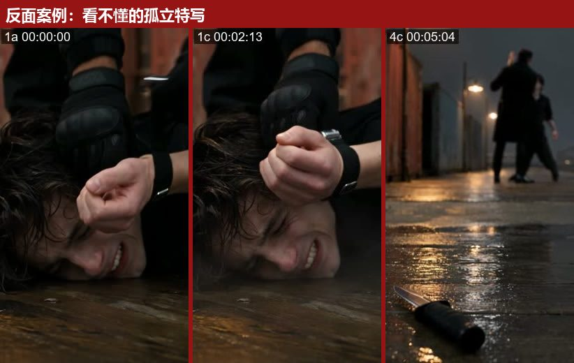
- ❌ `特写 85mm……蹲低朝伊森背在身后的手`；折刀滑走的特写；码头灯的空镜；一只手按着头。
- 成片：不知道是谁的手、要说什么。用户剪的时候删掉了折刀特写、双人被按住的全景、父亲在暗处的冷脸。
- ✅ 特写里要带出人：焦点从东西滑到人；或者并进前后镜里。空镜只留收场那种有用的（E30 段 4 最后一镜，钟声响起）。

## 06 全是固定机位、每镜都 3 秒（K8、K17）｜用户、剪辑
- ❌ 旧稿 28 镜里 23 镜写 `运镜：固定（……）`，时长几乎一样。
- 成片：呆。用户："很呆板""没有呼吸感"。
- ✅ 每镜写起点 → 怎么动 → 停在哪；一段最多一镜固定，写清为什么。焦段跟着变：广角给空间，标准镜给关系，长焦给情绪。

## 07 某一段的写法和别的段不一样、漏内容（K1、K23）｜用户
- ❌ 第 27 集段 2 有一版"借位版"，章节和别的段不一样，漏了构图、承接、声音；我（Claude）2026-11-23 的第一版 v2 砍到两三千字，把验证过的打斗句也删了。
- 用户："第二段的描述就完全跟其他段都不一样""改完的字数少了这么多"。
- ✅ 全集同一套章节、同一个顺序（V2 模板拼），正片 7,000–10,000 字。改稿只动有冲突的那几个字，字数变化主动说。
- 成稿：`成稿/❌反面_E27段2_短版_漏了打斗固定句.txt`

## 08 一串"不要音乐"（K3、K25）｜用户
- ❌ `不生成BGM：不要音乐、配乐、旋律，只保留对白、呼吸声……码头灯的嗡嗡声……`
- 为什么：说得越多模型越记得有；"嗡嗡"会被当成配乐底噪。
- ✅ 【声音】正着列现场声，最后一句 `无配乐，无字幕。`，全条只说这一次。

## 09 眼睛写"通红"（K11）｜看片
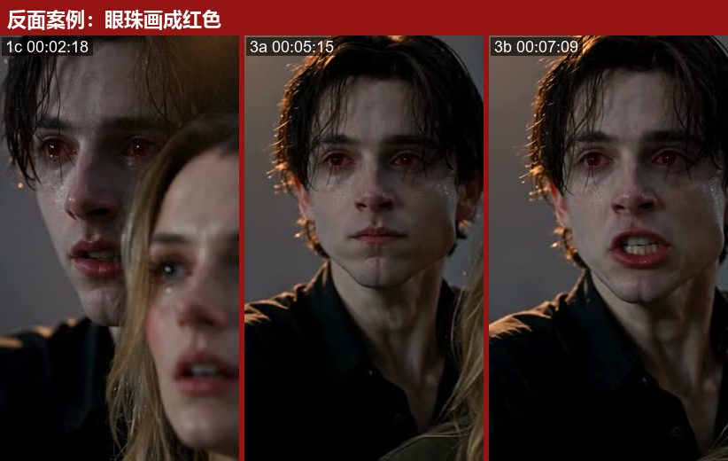
- ❌ `伊森通红的眼睛越过她的发丝`、`红着眼盯住`、`眼睛睁得通红`
- 成片：眼珠是红色的，像怪物。
- ✅ `眼里全是泪光`、`眼眶湿了`、`睫毛上挂着水珠`。（"眼眶泛红"E30 用过，没画红眼珠。）

## 10 衣服盖满镜头（K12）｜看片
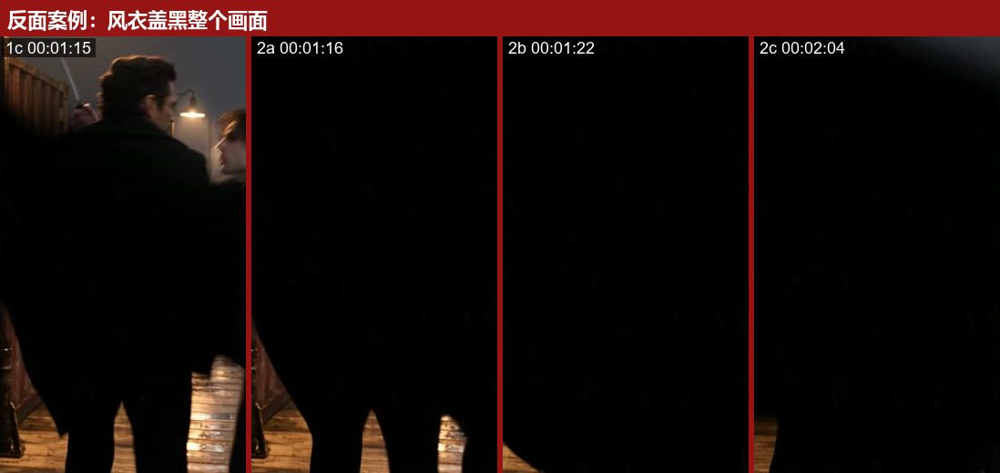
- ❌ `转身带起的风衣下摆从镜头前扫过，把两人的手遮住一瞬`
- 成片：整幅全黑 0.54 秒，剪的时候只能砍掉。
- ✅ `风衣下摆从画面左侧边缘擦过，两人的手始终看得见`。

## 11 把人整个裹住、挡住（K13）｜看片
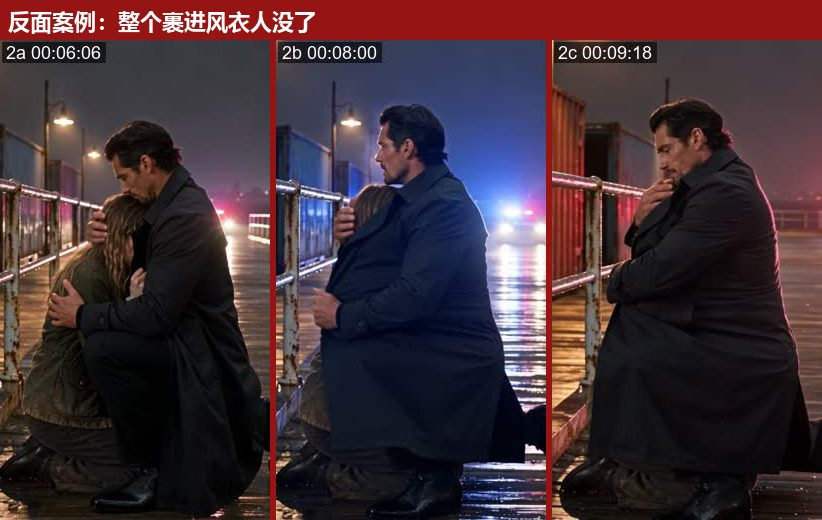
- ❌ `左手拉开风衣的前襟，把她整个裹进去`、`风衣合拢，她整个在里面`
- 成片：女儿从画面里消失，父亲抱着一团衣服。
- ✅ `把风衣前襟拉过她的肩，她的脸埋在他胸口，头发和攥着他衣领的手露在外面`。

## 12 光从镜头身后、画外来（K14）｜看片、用户
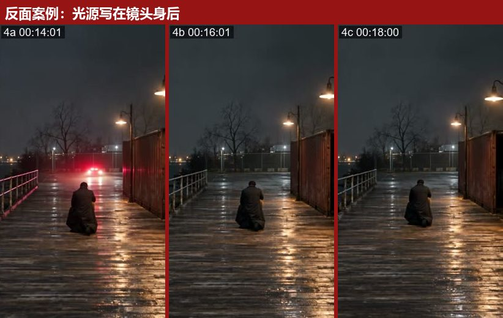
- ❌ `红蓝的光从镜头身后顺着湿木板推过去`
- 成片：模型把警车画进画面，闪一下就没了；方向变成朝陆地；父亲跪到了栈道正中。
- 用户："他不应该是蹲在中间的，他是靠在那个栏杆那里的""警车停在他们的前面要两三辆，一辆太少了"。
- ✅ 会变的光，光源写在画面里、全程都在：`陆地端并排停着三辆警车，车顶红蓝灯一直转`；全景里写人贴着哪样东西：`两人靠着右侧湖栏跪坐`（K26）。警车不挂参考图，只写字。

## 13 乱看没有由头（K19）｜用户
- ❌ `他的眼珠乱闪，刀、文森特、身后的湖`
- 用户："背景要有警笛声让他左顾右盼有依据"。
- ✅ `远处警笛声响起来，他的眼睛猛地往右闪了一下，又收回来`。眼神每动一次，写他听见或看见了什么。

## 14 段和段的动作接不上（L1、K6）｜用户
- ❌ 段 1 结尾伊森还差两步，段 2 开头已经在一臂远，机位也跳了。
- 用户："这里不够连贯他应该是扑向男主，然后机位也要改"。
- ✅ 收场停在动作中间的那一瞬，下一段开场逐字写同一瞬；第一镜运镜写`接着他扑出去的这一步……`。

## 15 冲刺的人张着嘴、没写嘴（K18）｜看片
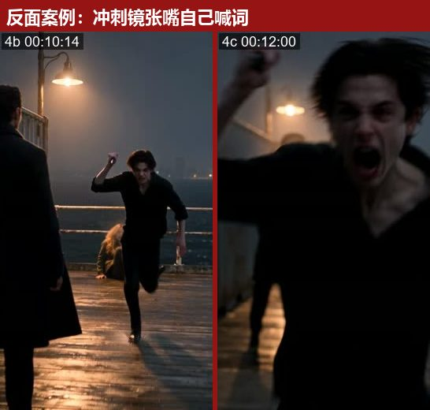
- ❌ `伊森……右手举起短刀，踩着积水直冲`（没台词的镜，没写嘴）
- 成片：自己喊了一句 "Fuck yeah!"。
- ✅ `牙咬着，只有粗喘`；这一条的人声写在【人物与表演】：`人声只有喘息和痛哼这类不带词的声音`。

## 16 落幅写死（K16）｜剪辑
- ❌ `落幅：刀静在积水里`、`镜头定格`、`暖的那一圈纹丝不动`
- 成片：镜尾十几帧静帧（刀落地后 13 帧），只能砍。
- ✅ 写还在动的：`水面还在一圈圈荡开`、`呵气一口一口散开`、`呼吸还在轻轻起伏`。

## 17 单人镜头里提画外的人（K20）、背景没交代（K21）｜看片
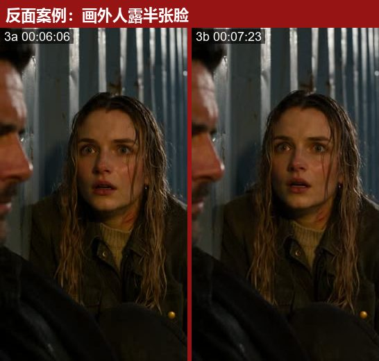
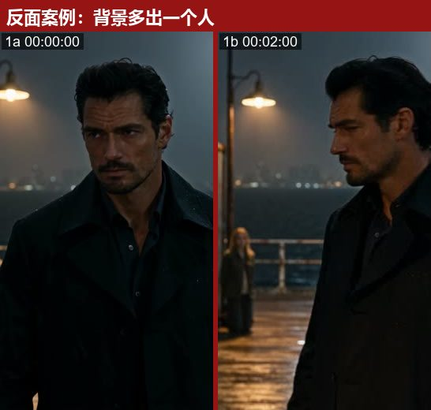
- ❌ 单人近景的构图里写 `看着左侧的文森特`，还挂了文森特的图；背景只写"尽头灯"，没写奥利维亚是坐着还是站着。
- 成片：画面左边缘伸进来半张脸；背景多出一个站着的女人（她应该坐在地上）。
- ✅ 单人镜头只写这一个人，看谁写 `视线擦着画面左侧镜头边`；背景里有人就写清姿态，没人就写背景是什么。

## 18 参考图一图多状态、同一人挂两张（K21）｜看片、推理
- ❌ 折叠刀开合拼在一张图、约束带和手铐拼一张；同一个人挂脸图又挂全身图；挂警车图、烟花图；不说话的人挂音频。
- 成片：道具状态乱跳、出两个同样的人、没人放却有烟花、不说话的人张嘴。
- ✅ 一人一张、一物一态；正在发生的（警灯、烟花、爆炸、雾）只写字；音频只挂这一段说话的人（V2 编译自动）。

## 19 衣服没写死、文件上有字（K28）｜看片
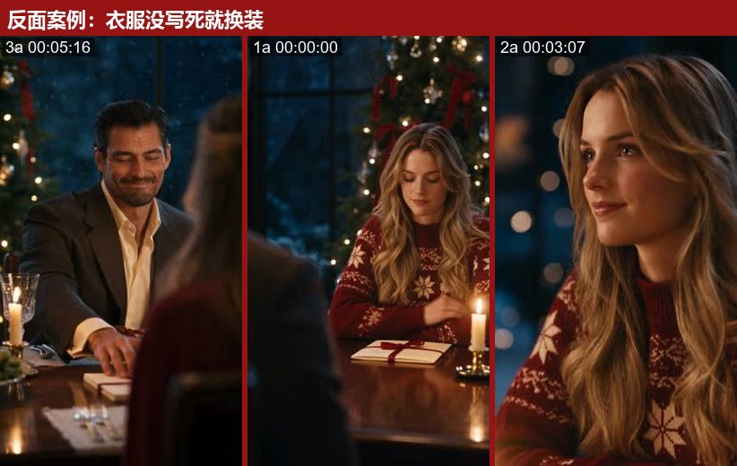
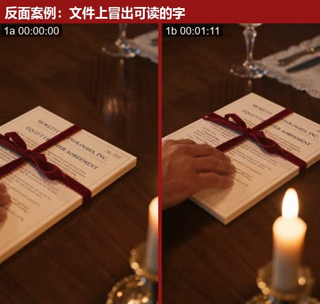
- ❌ 人物行只写"照参考图"，衣服没写；特写拍文件正面。
- 成片：同一场戏，段 1、3 砖红针织裙，段 2、4 变成雪花毛衣；文件上冒出一整页英文。
- ✅ 人物卡"固定"写颜色、料子、款式，每段一样。（E30 写了"砖红罗纹长袖针织裙"还是换了：参考图里的衣服和文字不一样时，图赢。先换参考图。）文件拍侧面、背面，或者丝带盖住正面。

## 20 编译时夹带的旧毛病（审查清单）｜Gemini 的审查员找到
- ❌ 资产行里写全集的镜号；只在某一镜发生的变化写进通用人物句；切镜后动作重演一遍；0.2 秒里塞三个动作；画面质感里留着上一场的道具；内心独白没写"画面里没人动嘴"；同一句话重复两遍。
- ✅ 一拍至少 0.5 秒、只装一个动作；变化写【本段变化】；质感行只写这一场有的东西；独白那一镜写`画面里没有人张嘴，声音是他的内心独白`。

## 21 动作镜太长（K17）｜剪辑
- ❌ 推开 3 秒、冲出去 3 秒、踹倒 2.5 秒。
- 成片：E27 从 125 秒剪到 83 秒，E30 从 97 秒剪到 87 秒；推开剩 1.13 秒，冲出 2.08 秒，踹倒 1.21 秒；每段开头空的半秒都被砍。E27 的 6 条 4 秒衔接镜一条都没用上。
- ✅ 没台词的动作镜 1.5–2.5 秒，一开头就在动作里。衔接镜只在承接画面怎么都接不上时才做。

## 22 把一次拦截当成规律｜看片（更正）
- ❌ E27 段 1 被平台判"可能涉及版权"，我（Claude）猜是"两张脸叠着 + 正对镜头冲"像某部片，改了镜头。
- 后来看：成片里的 `E27_分镜01.mp4` 正是被拦前的构图（两张脸叠着、正对镜头冲），说明这种构图能过（没上平台核对那条视频用的是哪一版文字）。猜测没有证据支持，多半是随机拦。
- ✅ 被拦先原样再生成一次；还拦，再一次只改一处去试（风格锁里的片名、平台名；画面里的字；像名场面的构图），记下哪一处改了才过。

## 23 构图限得太死｜用户
- ❌ 每一拍都写死人在画面哪一格、占几分之几、距离几步几寸。
- 用户："构图限得太死"。
- ✅ 一镜一句构图：主体在哪条三分线、前景是什么、看向哪、后面化开什么。剩下的给模型。
